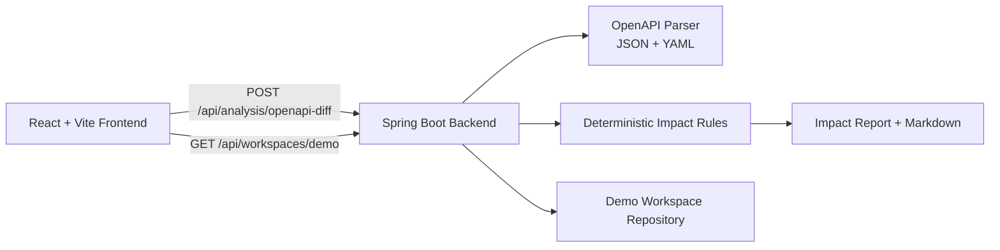

# Service Change Impact Radar

**Tagline:** _See what a code or API change could break across your microservices._

Service Change Impact Radar is a focused developer tool that compares API/event contract changes and maps likely impact across service consumers. It is designed for backend/platform/full-stack portfolio demonstration with deterministic, explainable rules.

> Demo notice: the bundled workspace, dependencies, and OpenAPI files are **demo data**.

## Problem
When API contracts or event schemas change in a microservices setup, dependencies are easy to miss during code review. This tool answers:
- What changed?
- Which services may be affected?
- Is it potentially breaking?
- What evidence supports the finding?
- What should be verified before merge/deploy?

## Features (MVP)
- Demo workspace with 5 services:
  - Customer Service
  - Order Service
  - Payment Service
  - Notification Service
  - Analytics Service
- Interactive dependency map with REST vs Kafka links
- Deterministic OpenAPI/Event diff checks:
  - endpoint removed
  - endpoint path renamed for same `operationId`
  - required field removed
  - required field added
  - field type/ref changed
  - enum values removed
  - event schema field/type/enum changes
- Evidence and verification recommendation per finding
- Risk summary and severity counts
- Upload own before/after OpenAPI files (JSON/YAML)
- Copy/download Markdown report
- Works without AI keys (no LLM dependency)

## Architecture


## Tech Stack
- Frontend: React, TypeScript, Vite
- Backend: Java 21, Spring Boot 3.3, Bean Validation
- Analysis: deterministic rule engine (no AI dependency)
- Packaging: Docker, Docker Compose
- Deployment template: Render Blueprint (`render.yaml`)

## Implemented API Endpoints
- `GET /api/health`
- `GET /api/workspaces/demo`
- `POST /api/analysis/openapi-diff` (multipart form-data)
  - fields:
    - `beforeFile` (optional if `useDemo=true`)
    - `afterFile` (optional if `useDemo=true`)
    - `providerService` (optional)
    - `useDemo` (`true|false`)

## How Impact Rules Work
The backend parses before/after specs and applies deterministic comparisons:
1. Compare path+method operation sets to detect removed endpoints.
2. Match same `operationId` across specs to detect likely endpoint rename/path change.
3. Compare component schemas by name:
   - removed fields,
   - added required fields,
   - type/ref changes,
   - enum value removals.
4. Compare `x-events` schema section similarly for event changes.
5. Map findings to likely consumers using workspace dependency records.

### Limitations
- Consumer usage of optional fields cannot be proven from schema alone.
- Dependency map is demo/static in this MVP (not auto-mined from repos).
- Rename detection is only reliable when `operationId` remains stable.

## Local Setup
### Prerequisites
- Java 21+
- Node.js 20+

### Backend
```bash
cd backend
./gradlew bootRun
```

### Frontend
```bash
cd frontend
npm install
npm run dev
```

Frontend expects backend at `http://localhost:8080` by default.
Override with `VITE_API_BASE_URL`.

## Docker Setup
```bash
docker compose up --build
```
- Frontend: `http://localhost:5173`
- Backend: `http://localhost:8080/api/health`

## Environment Variables
See `.env.example`.

- Frontend:
  - `VITE_API_BASE_URL`
- Backend:
  - `PORT`
  - `CORS_ALLOWED_ORIGINS`

## API Usage Example
```bash
curl -X POST "http://localhost:8080/api/analysis/openapi-diff" \
  -F "beforeFile=@customer-before.yaml" \
  -F "afterFile=@customer-after.yaml" \
  -F "providerService=customer-service"
```

Demo run (without upload):
```bash
curl -X POST "http://localhost:8080/api/analysis/openapi-diff" -F "useDemo=true"
```

## Testing and Checks
Backend:
```bash
cd backend
./gradlew test
```

Frontend:
```bash
cd frontend
npm run build
```

## Deployment (Render)
### Option A: Blueprint
1. Push this repository to GitHub.
2. In Render, create new Blueprint using `render.yaml`.
3. Update frontend service env var:
   - `VITE_API_BASE_URL=https://<your-backend>.onrender.com`
4. Update backend CORS:
   - `CORS_ALLOWED_ORIGINS=https://<your-frontend>.onrender.com`
5. Confirm health: `https://<your-backend>.onrender.com/api/health`

### Option B: Two web services
- Backend: Docker service from `backend/`, health path `/api/health`
- Frontend: Docker service from `frontend/` with build arg `VITE_API_BASE_URL`

## Future Improvements
- Repo import for public GitHub projects
- Service dependency auto-discovery from source code
- API version policy checks
- Persisted analysis history and trend view
- Optional AI explanation layer with strict source-attribution mode

## Recruiter Notes
This project demonstrates:
- Java backend API design with validation/error handling
- deterministic impact analysis logic with evidence trails
- microservice dependency modeling (REST + Kafka)
- TypeScript UI with interactive map and report export
- containerization and deployment-ready configuration
